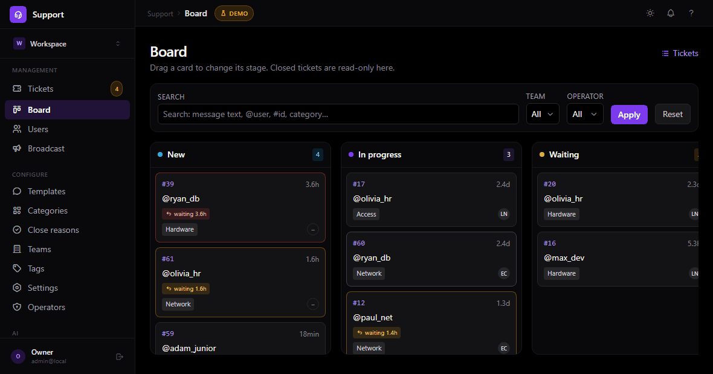
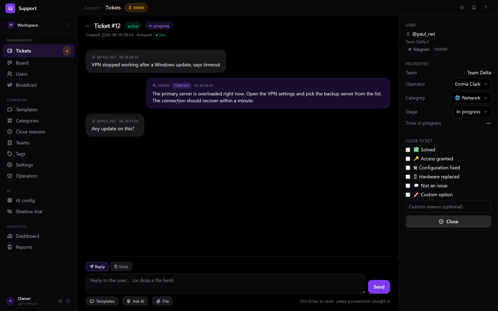
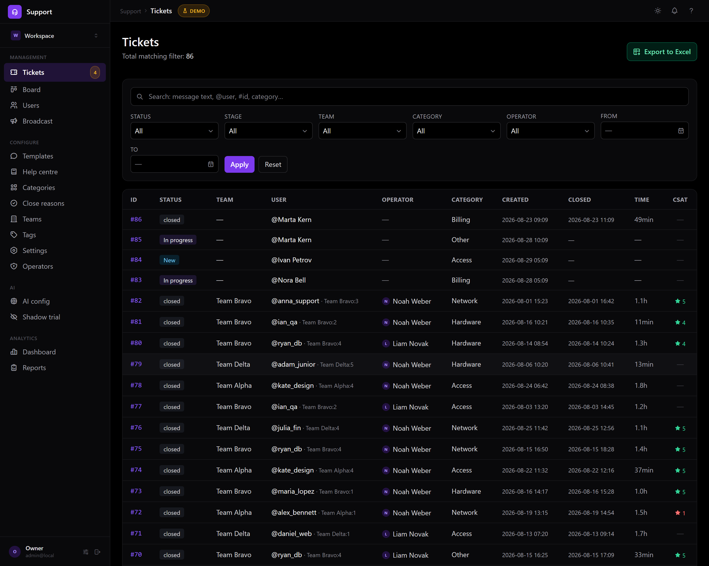
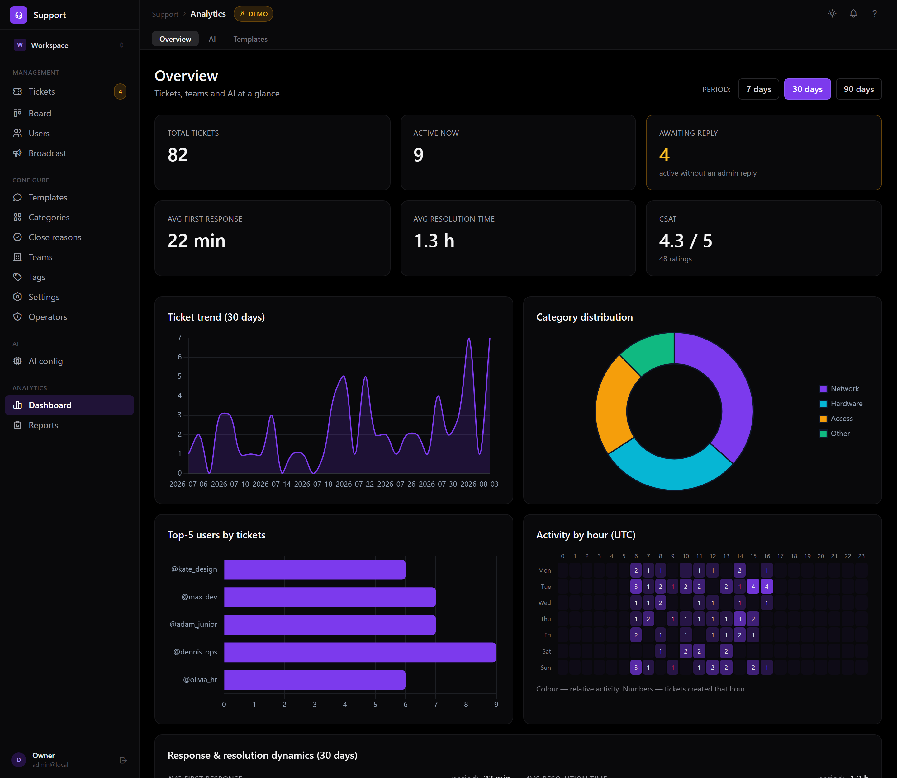
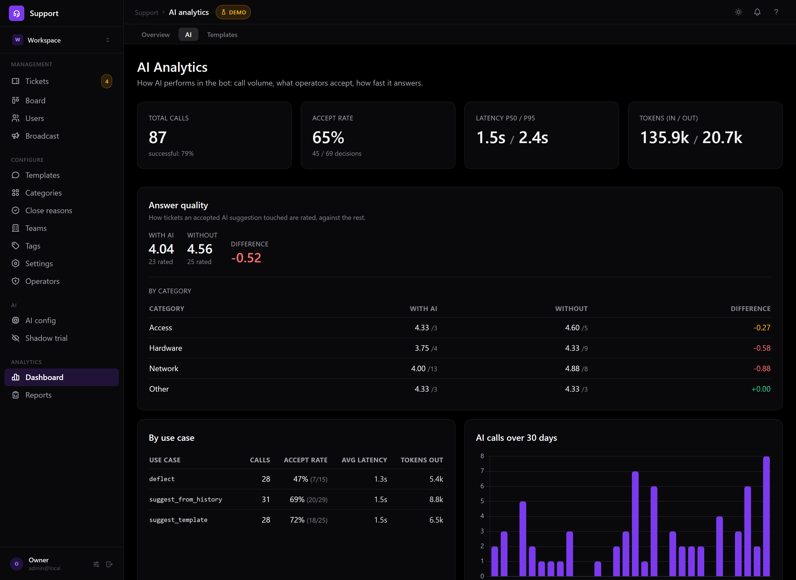
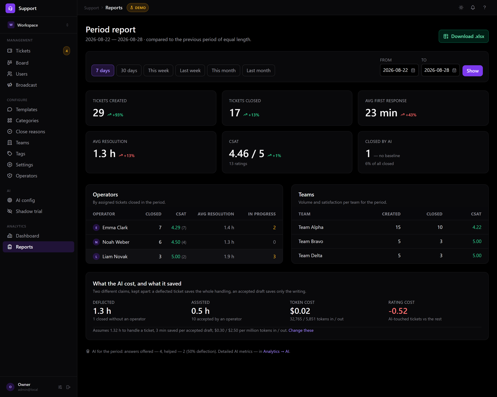
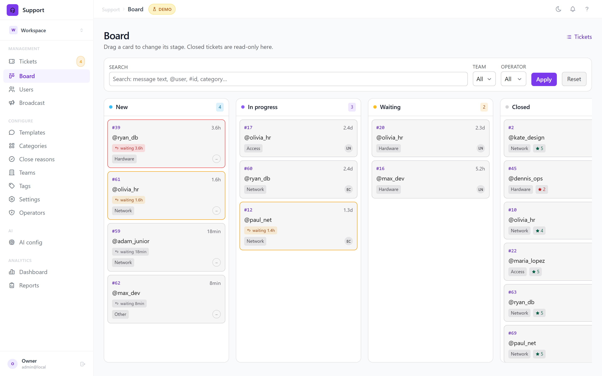
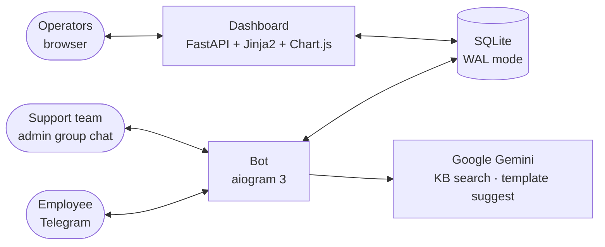

<h1 align="center">Spooldesk</h1>

<p align="center">
  <b>The open-source helpdesk your team never leaves Telegram to use.</b><br>
  Tickets live as Telegram threads. AI answers what it can before a human is needed.<br>
  Full web dashboard when you want one. Self-host in 5 minutes, one container.
</p>


### 🔴 [Live demo → app.spooldesk.net](https://app.spooldesk.net)

Log in with `admin@local` / `admin`. Runs on a free tier — if it was idle, the first load takes
**~30–60 s to wake up**. The demo database reseeds itself, so feel free to click, edit and break
anything. Sending replies to Telegram is disabled (the demo runs without a real bot token).



*The board is the work surface. A card shows whose move it is and how long they have
been waiting — in working hours, so an overnight wait is not a breach. Nothing owed
means no clock at all, which is why the Waiting column is quiet. Move a card and it
lands on your colleagues' boards too.*

> **Note:** every name, ticket and metric in the screenshots is **synthetic demo data** generated by
> [`scripts/seed_demo_data.py`](scripts/seed_demo_data.py) from word lists. No real conversation,
> customer or company data exists anywhere in this repository.

## Why Spooldesk

Every helpdesk asks your agents to live in *its* inbox. Spooldesk doesn't: a ticket is a
**thread in your Telegram admin group**, so the team answers where it already works —
and still gets a real dashboard, metrics and an audit trail.

|  | Spooldesk | Chatwoot / Zendesk / Freshdesk |
|---|---|---|
| Where agents work | **Telegram threads** (web optional) | separate inbox app |
| AI deflection | **built in, opt-in, measured** | paid add-on or absent |
| Deploy | **1 container, 5 min** | Rails/Postgres/Redis stack or SaaS-only |
| Your data | **your server, SQLite file** | their cloud |

### The story

Built while working as a Help Desk engineer: support requests were scattered across
personal DMs with no history, no metrics and no way to tell where the team's time went.
One Telegram bot replaced that — and grew into a full support platform.

## Features

**🎫 Ticketing in Telegram**
- User describes a problem, picks a category → a ticket thread is created in the admin group chat
- Two-way relay: replies in the thread go back to the user, full history stored per ticket
- Attachments, user verification, blocking, personal↔work account linking
- Multi-language users (uk / ru / en)
- **CSAT**: after a ticket closes the user rates support 1–5 right in Telegram; the score is immutable and surfaces on the dashboard

**🤖 AI assistant (Google Gemini)**
- Searches the internal knowledge base and suggests a solution for a new ticket
- Suggests the best canned reply template for typical scenarios
- Drafts answers based on similar resolved tickets ("this looks like ticket #47…")
- Every suggestion is Accept/Dismiss-tracked — accept rate, latency and token usage are measured, not guessed

**📋 Reply templates**
- Team-scoped library of canned replies with shortcuts and usage analytics
- One click to send from the ticket thread; AI picks candidates automatically

**📋 Board**
- Tickets as a Kanban board: New → In progress → Waiting, moved by drag
- A card carries whose move it is — the clock runs only while the customer waits on *you*,
  and counts **working hours**, so a message at 18:05 is not late by 09:00 the next morning
- Amber past the response target, red past twice it; nothing owed means no clock at all
- Colleagues' moves appear on your board without a reload, and the check that decides
  whether to redraw costs ~40 bytes
- **Internal notes** — operator-only, never sent to the customer and never used as AI context

**📊 Web dashboard (FastAPI + Jinja2 + Chart.js)**
- KPI overview: ticket trend, first-response / resolution time, **CSAT score**, category split, per-hour activity heatmap
- Full ticket base with filters and Excel export
- Users & teams management, ticket categories and close reasons editable from the UI
- AI analytics: calls, accept rate, latency p50/p95, tokens, per-use-case breakdown
- Per-operator accounts (argon2 password hashing), signed session cookies, CSRF protection, login rate limiting
- Dark / light theme

## Screenshots

| | |
|---|---|
|  *Reply, attach several files, or leave a note the customer never sees* |  *Ticket base with filters and Excel export* |
|  *Overview — queue health, response and resolution times, CSAT* |  *AI analytics — accept rate, latency, tokens* |
|  *Reports with period comparison* |  *Light theme* |

Every frame is regenerated by [`scripts/capture_screenshots.py`](scripts/capture_screenshots.py),
so they cannot quietly fall behind the product.

## Architecture



Two processes share one SQLite database in WAL mode: the bot (long-polling, aiogram) writes,
the dashboard (FastAPI) reads and manages. No message broker, no external DB — deliberately
boring infrastructure that one person can deploy and operate.

## Tech stack

| Layer | Tech |
|---|---|
| Bot | Python 3.13, aiogram 3, aiohttp |
| Web | FastAPI, Jinja2, Tailwind, Chart.js, Tabler icons |
| Data | SQLAlchemy 2.0 (async), SQLite + WAL, openpyxl (Excel export) |
| AI | Google Gemini via `google-genai` |
| Security | argon2-cffi, itsdangerous (signed cookies), CSRF tokens |
| Integrations | Telegram Bot API |
| Ops | Docker Compose, Makefile, interactive `.env` setup wizard |

## Try the dashboard in 2 minutes

The hosted **[live demo](https://app.spooldesk.net)** is the zero-effort option.
To run the same demo locally — no Telegram token, no API keys, everything on generated data:

```bash
python -m venv .venv && .venv/Scripts/activate   # Windows; use bin/activate on Linux
pip install -r requirements.txt
python scripts/seed_demo_data.py                  # builds demo_support.db with fake tickets
python scripts/run_demo_dashboard.py              # dashboard on http://127.0.0.1:8010
```

Log in with `admin@local` / `admin`.

## Full deployment

```bash
make setup   # interactive .env wizard (bot token, admin chat, AI key)
make up      # docker compose: bot + dashboard
```

See [DEPLOY.md](DEPLOY.md) for details.

## Development

```bash
pip install -r requirements.txt -r requirements-dev.txt
pytest -q        # 283 tests: auth, RBAC, CSRF, migrations, CSAT, search,
                 # AI deflection gates, working hours, reports, UI i18n
```

CSS is compiled Tailwind (no CDN at runtime). Rebuild after changing template classes —
see the header comment in [`tailwind.config.js`](tailwind.config.js).

## Licensing

Spooldesk is **fair-code**, licensed under the [Business Source License 1.1](LICENSE) —
the same model as Sentry and MariaDB.

**In plain terms:**

| You want to… | Allowed? |
|---|---|
| Run Spooldesk for your own company, in production, for free | ✅ Yes |
| Read, modify and fork the source | ✅ Yes |
| Deploy it for a client as part of your IT services | ✅ Yes |
| Resell Spooldesk **as a hosted/managed service** to third parties | ❌ Needs a commercial licence |

Every release converts automatically to **Apache 2.0** four years after publication
(current Change Date: **2030-07-28**). Nothing can be taken away from you later.

**Is this "open source"?** By the OSI definition — no, and I won't pretend otherwise:
BSL restricts one specific use (reselling it as a service). Everything else you'd
expect from open source is here: full source, no feature gates, no telemetry, no
seat limits, your data on your server. The single restriction exists so that a cloud
provider can't take this and outrun a solo maintainer with it. Need different terms?
Email [boykokuza12@gmail.com](mailto:boykokuza12@gmail.com).

## Roadmap

- **Webhooks / REST API** for integrations
- **Operator ↔ Telegram linking** — assignment notifications to the operator's own account
- PostgreSQL support for larger installations
- **Managed cloud** — hosted Spooldesk for teams that don't want to self-host

## Contributing

Issues and pull requests are welcome. [CONTRIBUTING.md](CONTRIBUTING.md) covers
local setup, what the test suite expects, and the few traps that are not obvious
from the code — chiefly that the Tailwind build is committed, so a class that is
not already in it silently does nothing.

## Author

**Kostiantyn Boiko** — designed and built end-to-end: bot, AI integration, dashboard UI, deployment.

- GitHub: [@vassab](https://github.com/vassab)
- Email: boykokuza12@gmail.com
