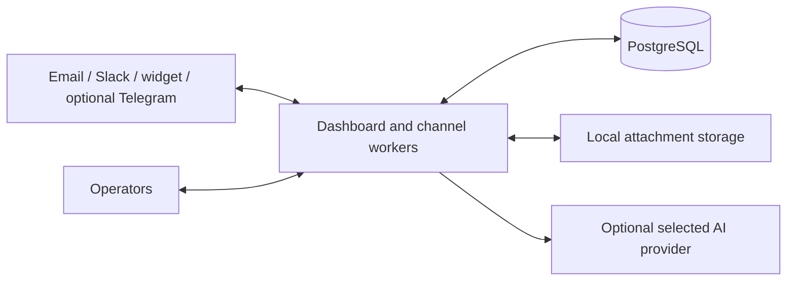

# Spooldesk

A self-hosted helpdesk for customer conversations across email, website chat,
Slack and optional Telegram. Operators work in one web dashboard.

**Release model:** one organization per installation, on infrastructure you
control. No Spooldesk cloud account, mandatory subscription or maintainer-owned
VPS is required. Source is available under [BSL 1.1](LICENSE), not an OSI
open-source licence. Paid installation and maintenance are separate services.

## Install

Download the assets from the selected [GitHub release](https://github.com/spooldesk/spool/releases).
Prereleases are installation candidates; second-computer acceptance is still
pending. A private repository requires signing in with an authorized account.

For a clean installation on another Windows computer, use the
[step-by-step guide](docs/SECOND_COMPUTER_INSTALL.md). Docker Desktop must use
Linux containers. Linux hosts use Docker Engine with Compose.

Extract a versioned source archive into a new directory, then run:

```sh
python scripts/setup.py
docker compose -p spooldesk up -d --build dashboard
docker compose -p spooldesk ps
```

Open `http://127.0.0.1:8000`. Sign in as `admin@local` with the password you
chose or generated during setup. This is a fresh PostgreSQL installation,
not the developer demo. Configure channels in the owner's **Integrations** tab.
The dashboard process runs the channel workers; a separate `bot` service is
available for legacy deployments but is not needed for this first installation.

The local address is only for testing on that computer. For a public installation,
use HTTPS and the production configuration in [DEPLOY.md](DEPLOY.md).
Prebuilt images must be selected by their supplied versioned tag using
`SPOOLDESK_IMAGE`; see the installation guide. Do not rebuild when testing the
prebuilt release artifact.

## What is included

| Area | Available workflow |
| --- | --- |
| Tickets | Active/closed queues, board, assignment, categories, search and exports |
| Conversations | Replies, internal notes, files, channel-aware edits/deletions, colleague typing indicators |
| Customers | Verification and team assignment, channel identities linked to a customer profile |
| Operators | Individual accounts, invitations, built-in and custom section roles |
| Knowledge | Draft/published articles, website help centre, reply templates |
| Analytics | Queue, response/resolution metrics, working-hour SLA and reports |
| Connections | Owner-only configuration, credential checks and delivery diagnostics |
| AI, optional | Ticket-content search/analysis, drafts, private chat history, text/DOCX files and confirmed status/assignee changes |

The AI provider is selected in settings: supported external providers include
OpenRouter; a supported Ollama endpoint can be used locally. Provider costs
and infrastructure are separate. The assistant does not execute arbitrary code.
Channel capabilities differ: an email already delivered cannot be withdrawn
from a recipient's inbox. See [USING.md](USING.md) and [FAQ.md](FAQ.md).


These illustrations use synthetic data. They are examples, not customer
endorsements or evidence of a tested capacity limit. The public landing has a
separate local interactive demo; it does not connect to a real helpdesk.

## Architecture



Docker uses Python 3.12, FastAPI, SQLAlchemy/asyncpg and PostgreSQL 16.
Incoming and outgoing jobs use database-backed queues and leases. Unknown
delivery is flagged for review rather than blindly resent. SQLite is retained
for isolated tests and legacy recovery, not new production installations.

One installation serves one organization. Teams are routing groups, not SaaS
tenants. Some limits are process-local and write transactions share a database
lock; no horizontal-scaling or load-capacity guarantee is made.

## Release and operations

Current scope, remaining gates and the distinction between code publication
and paid service launch: [self-hosted release](docs/SELF_HOSTED_RELEASE.md).
Local RC archives are not Git tags. Publish only the reviewed, versioned source
and matching tested container, with checksums and release notes.

Persist PostgreSQL and attachments, keep the encryption key separately, and
practice restoration. Backups and external uptime monitoring remain the
installation owner's responsibility unless explicitly included in a contract.
Connected messaging and AI providers receive the data needed for enabled
features; self-hosting alone does not establish privacy-law compliance.

## Documentation

| Guide | Purpose |
| --- | --- |
| [Second computer](docs/SECOND_COMPUTER_INSTALL.md) | Clean Windows installation, image loading and acceptance |
| [Deployment](DEPLOY.md) | Docker, TLS, configuration, channel setup and troubleshooting |
| [Operator guide](USING.md) | Daily ticket and customer workflows |
| [FAQ](FAQ.md) | Requirements, licensing and current limits |
| [Connections](docs/CONNECTION_CENTER.md) | What integration diagnostics do and do not prove |
| [AI assistant](docs/AI_ASSISTANT.md) | Permissions, context, files and chat history |
| [PostgreSQL](docs/POSTGRESQL.md) | Database setup and migration policy |
| [Backup and restore](docs/BACKUP_RESTORE.md) | Recovery and outbound quarantine |
| [Releasing](docs/RELEASING.md) | Source/image provenance, checksums, publication procedure |
| [Legal preparation](docs/LEGAL_READINESS.md) | Licence, seller setup and privacy work before paid services |
| [Landing](docs/LANDING.md) | Bilingual site sources and public-only export |
| [Security](SECURITY.md) | Reporting issues and deployment boundaries |

Date-stamped audits in `docs/` are historical snapshots, not current product
instructions. [LOCAL_PREVIEW.md](LOCAL_PREVIEW.md) describes this repository's
developer preview only; never use its demo credentials for a customer install.

## Development

```sh
python -m pip install --require-hashes --only-binary=:all: -r requirements.txt -r requirements-dev.txt
python -m pytest -q
node --test tests/frontend/*.test.cjs
```

Tests use disposable databases and fake providers. The supported container
runtime is Python 3.12. See [CONTRIBUTING.md](CONTRIBUTING.md); do not use a real
customer database or live messaging for tests.

## Licence and contact

The current BSL Additional Use Grant permits own production use within its
terms. Providing third parties a hosted or managed service with a substantial
set of the product's functionality requires separate rights. Installer/MSP
arrangements need assessment against the actual licence; there is no blanket
reseller permission. The licence specifies its change date and change licence.
Optional paid services do not remove rights already granted for a version.

Project author and licensor: **Kostiantyn Boiko**.
Product and licensing enquiries: [hello@spooldesk.net](mailto:hello@spooldesk.net).
Issues and contributions: [contribution guide](CONTRIBUTING.md).
