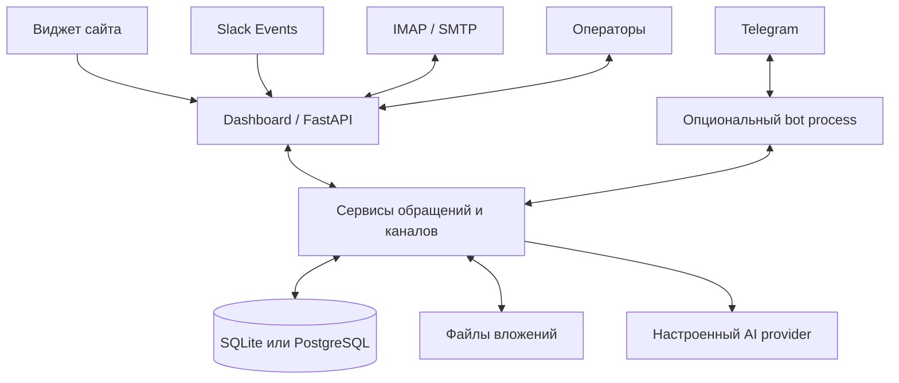

# Spooldesk: аудит проекта и готовности к запуску

Дата: 17 сентября 2026. Исходный commit: `0b3745b`. Связанный документ: [стратегия и монетизация](PRODUCT_STRATEGY_2026-09-17.md).

Это исходный снимок до следующего этапа разработки. Выполненные после аудита исправления и оставшиеся условия запуска описаны в [актуальном отчёте готовности](RELEASE_READINESS_2026-09-17.md).

## Решение

Spooldesk — содержательный прототип мультиканального helpdesk с хорошей основой для небольшого коммерческого продукта. Его главный следующий этап — надёжность и первые реальные внедрения. Сейчас публично обещать готовый промышленный сервис рано: воспроизведены потери входящих сообщений, нарушения целостности данных и расхождения правил между каналами. Часть уязвимостей интерфейса исправлена в ходе этого аудита; остальные проблемы ниже явно остаются открытыми.

Telegram — один из адаптеров. Основной продукт — общий операторский портал, история обращений, ответственность за следующий ответ и помощь клиенту через привычный ему канал. Название рабочей папки уже не отражает масштаба проекта.

У продукта пока нет пользователей и платящих клиентов — это подтверждено владельцем. Следовательно, спрос, удержание, экономия времени и готовность платить ещё не проверены. Домен и Fastmail — полезная инфраструктура старта, но не доказательство бизнес-модели.

## Объём и ограничения проверки

На входе: 274 tracked-файла, 92 Python-модуля в `src`, примерно 25 231 строка Python приложения, 56 тестовых модулей. Проверены архитектура, backend, база, сервисы, каналы, handlers, AI, dashboard, шаблоны и JS, тесты, скрипты, CI, Docker, документы и лендинг. Три независимые области изучались параллельно, выводы и изменения затем сверены.

Проверка не включала чтение `.env`, содержимого рабочих БД, сообщений клиентов или личных настроек редактора. Диагностические сценарии использовали временные БД и mock transports. Изменения не опубликованы, серверы и платные сервисы не настраивались, сообщения никому не отправлялись.

Что действительно выполнено:

- Исходный полный pytest: **854 passed**, 2340 предупреждений, 151,30 секунды.
- Исправления безопасности: **14 новых regression cases**, включая реальные HTTP endpoints и рендер шаблонов; toast JS дополнительно исполнен через Node с минимальным DOM stub.
- Отдельные проверки после очистки: backend **151 passed**, channels/AI **147 passed**; они входят в общую suite и не прибавляются к её размеру.
- Проверены Python AST всех исходников и скриптов, отсутствие callers удалённых helpers, зависимости через `pip check`.
- Setup без Telegram проверен во временном каталоге, с генерацией ключей и без изменения настоящего `.env`.
- Итоговый полный pytest после изменений: результат внесён в раздел «Итоговая проверка» в конце документа.

Локальная среда — Windows/Python **3.13.14**; Docker и CI задают **3.12**. Docker CLI установлен, но Docker daemon недоступен. Поэтому контейнер, production Linux и PostgreSQL в этой сессии не запускались. PostgreSQL, сборка image и deployment-проверки присутствуют в CI, но свежий успешный CI run здесь не проверен. Реальные Telegram/Slack/IMAP/SMTP/LLM API, браузерный E2E, нагрузочный тест и восстановление backup не выполнялись. `pip check` не является сканированием CVE.

## Что уже реализовано

| Область | Реализация и практический смысл |
|---|---|
| Общая модель | `User → Ticket → Message`; статусы, этапы, команда, ответственный, причины закрытия, CSAT |
| Каналы | Widget, email, Slack, Telegram; общий `Channel`, `Capabilities`, `Delivery` |
| Работа оператора | Доска, очередь, фильтры, поиск, сохранённые представления, назначения, внутренние заметки, файлы, шаблоны |
| Знания | Статьи с draft/published, публичный help centre и поиск из виджета |
| AI | Выбор шаблона, черновик по истории, ограниченная автоматическая помощь; Gemini/Anthropic/OpenAI/Ollama; счётчики latency/tokens/outcomes |
| Управление | Операторские учётные записи и роли, пользователи/команды, категории, настройки, языки, персональные предпочтения |
| Метрики | First response, resolution, рабочие часы, SLA, CSAT, отчёты, XLSX |
| Эксплуатация | Compose, TLS через Caddy, health/watchdog, SQLite backup и cron; PostgreSQL overlay |
| Защитная основа | Argon2, подписанные cookies, CSRF, Slack signatures, хеширование widget tokens, шифрование AI keys, фильтрация внутренних заметок |

Функции существуют в коде, однако степень их завершённости различается. Например, общий интерфейс каналов ещё не гарантирует одинаковую отправку вложений из каждого операторского интерфейса.

## Архитектура и границы

Dashboard принимает widget/Slack и запускает email polling; bot получает Telegram updates. Оба процесса используют базу и сервисы. Часть Telegram-логики пока обходит общий intake. Планировщик SLA находится в bot, поэтому продукт ещё не полностью независим от Telegram на уровне фоновых задач.

Одна установка рассчитана на одну организацию. `Team` — рабочая группировка, **не tenant и не граница безопасности**. Между командами нет полноценной изоляции операторского доступа; несколько компаний нельзя безопасно размещать в одной текущей БД через разные команды. Для первых клиентов нужны отдельные экземпляры, БД, ключи и каталоги вложений.

Один `User` привязан к одному каналу. Один человек в email и widget — две записи. Заявлен один активный тикет на клиента. Это ограничивает полноценный helpdesk: две независимые темы одного email сейчас объединяются, Slack threads не являются отдельными обращениями. Даже существующий инвариант одного активного тикета нарушается при конкурентном intake.

## Что удалено и приведено в порядок

1. **13 неиспользуемых функций:** `language_for`, `looks_encrypted`, `clear_on_reply`, `list_for_team`, `count_for_team`, `count_internal_notes`, старый `csat_service._record`; `_language_of`, `_team_selection_keyboard`, `_cb_team`, `received_at`; `admins_by_replies`, `_forget`.
2. Неиспользуемые импорты и константы `CATEGORY_KEYS`, `_PATTERNS`; 181 строка полностью закомментированного старого follow-up. Работающий scrubber сохранён.
3. Пять неиспользуемых изображений из `docs/img`: `spooldesk_light.png`, `spooldesk_dark.png`, `spooldesk_compact.png`, `13_widget_home.png`, `15_widget_chat.png`. Поиск ссылок подтвердил отсутствие использования; освобождено **477 902 байта**. Используемые README/screenshots, иконки, исходники бренда и генераторы сохранены.
4. Из README и лендинга убраны недостоверные общие сравнения с конкурентами, обещания отдельной forum topic на каждый тикет, обязательность Telegram и противоречивое позиционирование BSL как OSI open source. Лендинг обозначает managed как предложение пилота, а не доказанно готовую услугу.
5. Обновлены устаревшие описания AI, privacy, архитектуры и разработки. Setup позволяет пропустить Telegram. В `.dockerignore` добавлены данные, backups, ключи и ненужные runtime-образу материалы.
6. Исправлен существующий тест workflow, который зависел от случайно оставшегося оператора `id=7`: тест теперь создаёт собственную запись.

Не удалены схемные legacy-поля и миграции, используемые demo/build/backup scripts, публичный adapter API, рабочие данные, окружение и личные настройки. Их удаление по одному названию было бы риском, а не очисткой. Нет оснований выбрасывать email/Slack/AI только из-за отсутствия клиентов.

## Исправления безопасности, выполненные сейчас

| Проблема | Внесённое исправление | Проверка |
|---|---|---|
| Имя посетителя закрывало `<script>` на `/users` и `/overview` | Routes передают данные, шаблоны используют Jinja `tojson` вместо JSON + `safe` | HTTP/render с вредоносным именем, сохранение правильной структуры JS |
| `?toast=` исполнялся через `innerHTML` | Сообщение вставляется через `textContent`, удалено повторное декодирование | Endpoint + исполнение функции JS |
| Brand name попадал в HTML hint через `safe` | Значение экранируется до форматирования | Рендер настроек |
| SVG/HTML и поддельный MIME могли исполняться на origin панели | Raster-only inline, безопасный MIME, download для остальных, `nosniff`, CSP `sandbox`, корректный UTF-8 filename | Widget и operator download endpoints |
| Произвольный `X-Spooldesk-Session` обходил лимит новых посетителей | Неизвестный token считается новым посетителем, учитывается IP-лимит, выдаётся новый server token | Message и upload, проверка 429 и отказа старому token |
| `next=//external-host` давал внешний redirect | Общая проверка локального пути в GET/POST login | Внешние/обратные слеши/control chars и допустимый локальный URL |

Практическое изменение: PDF, SVG, audio/video и другие нерастровые файлы теперь скачиваются. Файлы с неизвестным расширением могут потерять inline preview; это осознанное ограничение. Места, где UI ещё пытается показать их как картинку, стоит согласовать с allowlist.

## Открытые блокеры: исправления выше не закрывают их

Приоритет здесь означает порядок до коммерческого запуска. «Воспроизведено» — реальный код на временной БД/HTTP или вызов сервиса с mock внешнего транспорта; это не утверждение, что внешний production API проверен. «Чтение кода» отдельно обозначает вывод без сквозного воспроизведения.

| ID | Проблема и доказательство | Где | Критерий исправления |
|---|---|---|---|
| R01 | **Email теряется:** при временном DB error письмо всё равно становится Seen. Воспроизведено. Используются sequence numbers вместо UID; нет durable dedupe | `src/services/email_ingest.py`: `_fetch_unseen`, `_mark_seen`, `run_once` | UID+UIDVALIDITY, persistent event key, Seen после commit; временный отказ не теряет/дублирует письмо |
| R02 | **Slack retry теряется:** event заносится в `_seen` до commit; первая обработка падает, повтор получает 200 без нового intake. `file_share` отбрасывается по subtype. Воспроизведено | `src/dashboard/routes/slack.py`: `_already_handled`, `events` | Durable inbox, ACK после сохранения, idempotency и отдельный contract test file_share |
| R03 | **Ложная успешная доставка widget:** `send_text` — no-op; ошибка записи transcript проглатывается. Воспроизведено | `src/services/outbound.py`: `say`; `src/channels/widget.py` | Widget success только после commit; внешним каналам persistent outbox со статусами и retry |
| R04 | **SQLite production отличается от тестов:** FK включены только при TESTING. Удаление команды оставляет orphan references и шаблоны. Воспроизведено на свежей production-mode БД | `src/database/db.py`: `_register_sqlite_functions`; `team_service.delete_team` | Repair/migration старых данных, FK в production, тесты каскадов на обоих движках |
| R05 | **Гонка intake:** два одновременных обращения создают два active ticket одному клиенту. Воспроизведено | `src/services/intake_service.py`: `receive`; models | Явный conversation key, уникальные ограничения/upsert и конкурентные тесты. Сначала определить поддержку нескольких тем |
| R06 | **SLA не универсален:** loop живёт только в Telegram bot; обычный текстовый reply не сбрасывает breach marker. Второе воспроизведено, первое подтверждено по всем местам запуска | `src/main.py`; `sla_service`; `template_service`; `workflow_service` | Общий worker независимо от каналов; повторный цикл ожидания снова контролируется; неуспешный alert повторяется |
| R07 | **Health почты ложно зелёный:** run_once возвращает error, poll_loop записывает last_success. Воспроизведено | `src/services/email_ingest.py`; `health._mailbox` | Неверный пароль/IMAP outage дают degraded/503 и уведомление; recovery действительно проверен |
| R08 | **AI policy обходится вручную:** endpoint вызывает history при AI disabled и запрещённой категории. Вызов mock LLM воспроизведён | `src/dashboard/routes/tickets.py`: `ticket_ai_suggest`; `src/ai/suggest_from_history.py` | Единый policy внутри use cases; ни один endpoint не обходит disabled/category/scope правила |
| R09 | **Telegram operator surface обходит роли панели:** член группы без AdminUser может закрыть тикет; callbacks не имеют общего ACL. Воспроизведено при доступе к операторскому интерфейсу, не заявляется публичный internet bypass | `src/handlers/admin_handlers.py`; `ticket_actions.py` | Связанный активный оператор, единые permissions, отзыв доступа во всех интерфейсах |
| R10 | **Тикет угадывается по любой цифре:** текст `Team meeting in 1 minutes` сопоставляется с #1 и может уйти клиенту. Воспроизведено | `src/handlers/admin_handlers.py`: `_find_ticket_by_text` | Явная команда/ответ на конкретное сообщение, отсутствие произвольного fallback |
| R11 | **Forum topics не создаются:** код ждёт новую тему от sendMessage; mock делает именно это. С общей темой два ticket дают MultipleResultsFound. Воспроизведены последствия, live API не вызывался | `announce_service`; `user_handlers`; `tests/test_announce.py` | Вызов `createForumTopic` либо корректный reply-routing без этого обещания; contract test по реальному API |
| R12 | **Telegram-file reply в другие каналы не маршрутизируется:** отправка идёт в Telegram на отрицательный internal id. Воспроизведено | `src/handlers/admin_handlers.py`: attachment path | Отправка через Channel adapter; text+files проходят полный круг во всех включённых каналах |
| R13 | **Управление доступом неполно:** password reset не отзывает старую cookie; последний owner может сделать себя agent; удалённый widget user снова пишет. Всё воспроизведено | `auth.py`, `admin_user_service`, `routes/admin_users.py`, `user_service.remove`, `intake_service` | Session version/revocation, хотя бы один активный owner, однозначные disable/remove правила |
| R14 | **XLSX formula injection:** visitor name `=1+1` становится формулой в экспорте. Воспроизведено | `src/dashboard/routes/tickets.py`: XLSX export | Все пользовательские поля записываются как текст; тесты `=`, `+`, `-`, `@` и служебных префиксов |
| R15 | **Обновления схемы не готовы:** PostgreSQL получает create_all, без upgrade миграций; SQLite без версий. Установлено по коду | `src/database/db.py`; `dialect.py` | Versioned migrations и тест обновления с предыдущего релиза плюс восстановление |
| R16 | **Backup/restore не доказан:** DB snapshot и копирование files не атомарны; инструкция начинается с down, удаляющего контейнер для последующего cp; offsite и restore drill отсутствуют | `scripts/backup.sh`; `backup_schedule.sh`; DEPLOY | Проверенный runbook: пустая машина → DB+files+ключи → рабочий login и ответы; offsite, retention и alarm |
| R17 | **Verified identity шире подписи:** HMAC покрывает external_id или email, а доверенным считается весь набор полей. Найдено чтением кода, account takeover не утверждается | `src/channels/widget.py`: identity verification; `src/services/intake_service.py`: `_adopt_identity` | Подписывать канонический payload либо явно отмечать только подтверждённое поле. До исправления не принимать решения по неподписанным email/name |

Основание R11: [Telegram createForumTopic](https://core.telegram.org/bots/api#createforumtopic). Основание части R16: [Docker compose down удаляет контейнеры](https://docs.docker.com/reference/cli/docker/compose/down/). Это внешние контракты, которым локальные mocks и инструкции должны соответствовать.

Для пилота можно отключить неиспользуемый канал или AI и сузить согласованный объём. Нельзя оставлять потерю данных/нарушение доступа в том пути, который реально продаётся. Отключение Telegram не исправляет email/widget/SLA.

## Что ещё не хватает по функциональности

### До первых рабочих внедрений

- Общие lifecycle-события: create, customer replied, operator replied, waiting, close/reopen, assignment. Сейчас одинаковое действие разных каналов приводит к разным состояниям.
- Email threading по Message-ID/In-Reply-To/References; разные темы одного клиента. Хранение исходного письма для диагностики ошибок trimming.
- Явное сохранено/отправляется/отправлено/ошибка, повторная отправка, журнал доставок. Нельзя показывать оператору успех, когда клиент ответа не получил.
- Общий журнал действий с реальным operator_id; сейчас sender_id часто равен 0, логов недостаточно для расследования.
- Wizard первого запуска: каналы, тест отправки, invite оператора, часы, бренд, первый ticket. Секреты вводятся безопасно, preflight показывает проблемы конфигурации.
- Политика удаления, хранения, выгрузка данных клиента, квоты вложений и диска. Текущий soft retirement не является полным удалением данных.
- Сброс пароля, управление сессиями; для доступного из интернета платного сервиса желательно 2FA владельца и операторов.
- Полный круг text/files/follow-up/close/CSAT для каждого продаваемого канала. Email CSAT сейчас не имеет кликабельного feedback-flow.

### До масштабирования

- Provisioning отдельных workspace, billing/invoices, usage limits, отмена подписки, экспорт и lifecycle удаления. Это отсутствует как готовый SaaS-процесс.
- REST API и webhooks с ключами, scope, подписями, idempotency и журналом retry.
- Гибкие правила назначения/эскалации, приоритеты, несколько SLA-политик — по повторяющимся клиентским сценариям.
- Безопасная связка идентичностей одного человека между каналами и customer portal с несколькими обращениями. HMAC сейчас подписывает external_id **или** email, но UI может воспринимать всю identity как verified; нужно явно определить подписанные поля.
- Фоновая очередь, распределённые rate limits, единый scheduler/leader, объектное хранилище при необходимости; PostgreSQL сам по себе не решает процессы, locks и локальные файлы.
- Контроль зависимостей, reproducible lock/constraints, обновления framework, vulnerability scanning. CI должен проверять production-конфигурацию, upgrades, concurrency и реальные схемы интеграций.

### Отдельно про AI

AI provider abstraction сделана хорошо, но сама помощь ещё не является сильным конкурентным преимуществом. History берёт недавние закрытые обращения по team/category, а не выполняет полноценный семантический поиск. Automatic deflection запускается только Telegram-путём. Payload `defl` расходится с ожидаемым `deflect` в общем обработчике кнопок. При `team_id=None` есть риск слишком широкого scope шаблонов. На длинной истории начало текста сохраняется, новые уточнения могут отрезаться.

Нужны единый policy, корректные scopes, обработка удалённых сообщений, budget/concurrency limits, замеры качества на 50–100 согласованных кейсах, источники ответа и повторная проверка состояния тикета перед отправкой. Scrubber скрывает некоторые credential patterns, но не гарантирует отсутствие персональных данных. Автоответы включать для ограниченных проверенных сценариев; базовый режим первого пилота — подсказки с решением оператора. Acceptance и «клиент нажал помогло» не равны доказанной экономии часов.

Прочие подтверждённые/выявленные хвосты: Sticker вызывает AttributeError из-за отсутствующего mime_type; template formatter падает на attribute placeholders; broadcast остаётся Telegram-oriented и теряет задачи при restart; first widget multi-upload стартует параллельно до получения token (риск разных тикетов, найден чтением JS); process-local buckets не имеют общего состояния; ключ шифрования создаётся без надёжной межпроцессной координации.

Отчётность тоже требует проверки определений: overview усредняет дневные средние без веса числа обращений, AI quality и savings могут использовать разные периоды; XLSX export игнорирует фильтр assigned. Карточка клиента ещё содержит прямую отправку через Telegram даже для других каналов. Эти несоответствия найдены чтением кода; до использования отчётов для оплачиваемого ROI нужно сверить расчёты с исходными событиями.

## Степень готовности

Это инженерные диапазоны для разных целей, а не измерение процента кода и не вероятность успешного бизнеса.

| Цель | Оценка после текущей очистки | Решение |
|---|---:|---|
| Демонстрация на синтетических данных | 80–85% | Показывать можно, честно оговаривая ограничения |
| Ограниченный платный пилот одной компании | 55–60% | Сначала закрыть блокеры используемых путей и пройти gates ниже |
| Публичный SaaS с самостоятельной регистрацией и оплатой | 30–40% | Пока не запускать: нет полного коммерческого/операционного контура |
| Enterprise/регулируемые данные | Низкая | Не брать как стартовый сегмент |

Сильнее всего готовы операторский интерфейс и широта базовых функций. Слабее — доставка, целостность, единые права/политики, восстановление и коммерческая эксплуатация. Процент теряет смысл, если хотя бы один критичный сценарий теряет письмо или выдаёт чужие данные.

## Условия допуска к первому пилоту

1. Для согласованных каналов нет открытых критичных security/data-loss дефектов. Каждый R-ID закрыт проверкой либо канал/функция явно исключены из пилота.
2. 100% scripted scenarios: входящий текст и файл → ответ → follow-up → назначение → ожидание → закрытие → оценка → новое обращение. Включены два параллельных сообщения, два оператора и несколько тем одного клиента.
3. При остановке DB, SMTP, IMAP, внешнего API, worker и рестарте сообщения остаются в durable queue; нет тихой потери, повторы управляемы. Внешняя доставка не обещается как exactly-once там, где provider не поддерживает idempotency.
4. Реальные sandbox/тестовые аккаунты интеграций; схема mocks соответствует провайдерам. Выполнен браузерный E2E виджета и панели.
5. На чистой машине восстановлены БД, файлы и конфигурация ключей; секреты хранятся отдельно от обычного архива данных. Начальные цели: RPO до 24 ч, RTO до 4 ч — только после замера, без преждевременного SLA клиенту.
6. Внешний uptime monitor, delivery lag/error alerts, проверка возраста backup, квот и свободного диска. Проверена реальная недоступность, а не только успешный ping.
7. Для пилота определены поддержка в рабочее время, каналы обращения, границы ответственности, хранение/экспорт/удаление данных и условия оплаты.
8. Нагрузка выбрана из объёма клиента с запасом, измерены p95 endpoints, locks, memory и queue lag. Произвольное число «поддерживаемых операторов» не публикуется без замера.

Следующие работы и коммерческие критерии — в [стратегии](PRODUCT_STRATEGY_2026-09-17.md). Текущий аудит не включает исправление всех R01–R17: это отдельный существенный этап разработки, перечисленный конкретно и проверяемо.

## Итоговая проверка

Полный повторный запуск после всех изменений исходников: **868 passed**, 2441 предупреждение, 160,62 секунды (`python -m pytest -q --disable-warnings`). `git diff --check` чистый. Предупреждения, включая устаревшие lifecycle/datetime API, не скрывают падения тестов, но остаются техническим долгом.

Исправления dashboard дополнительно просмотрены независимым аудитором: новых блокирующих регрессий в diff не найдено. Это не заменяет отсутствующие live integration, browser E2E, Linux/3.12, PostgreSQL и restore-проверки, перечисленные выше.
